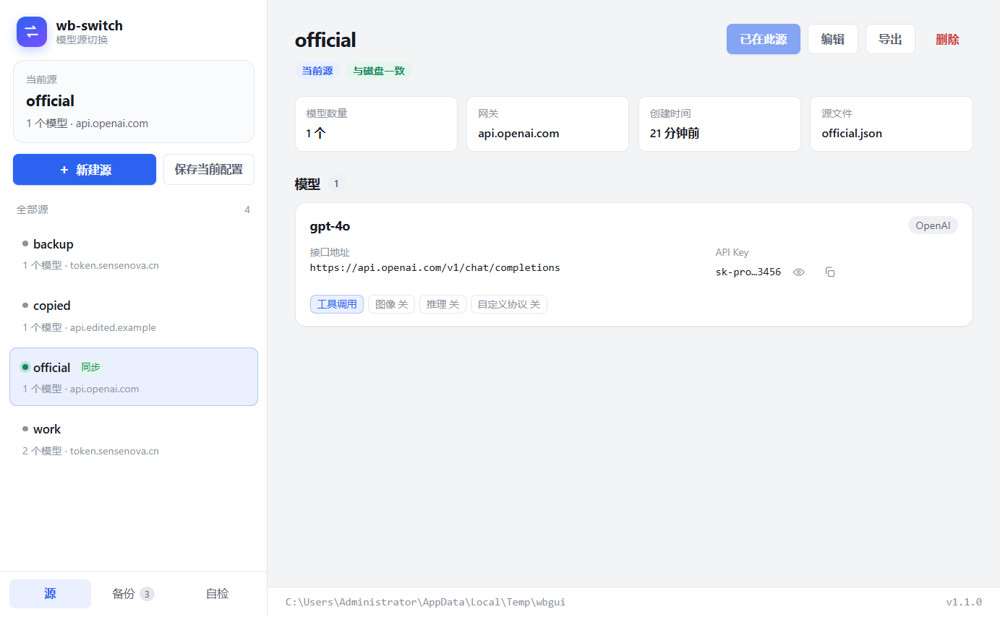
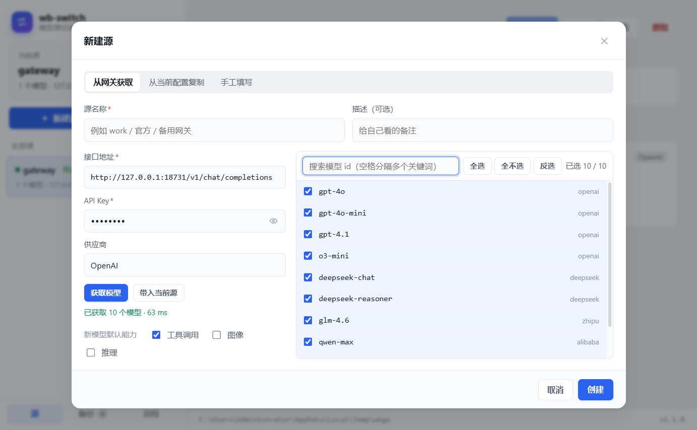

# wb-switch

WorkBuddy 的**模型源切换器**：把不同的模型网关配置存成一个个「源」，用图形界面一键来回切换，不用再手改 `~/.workbuddy/models.json`。



## 它解决什么问题

`C:\Users\<你>\.workbuddy\models.json` 里存着 WorkBuddy 的自定义模型（网关地址 + API Key）。官方源、中转站、公司内网网关往往只能存一份，换一个就得手工改一遍 JSON，改坏了还可能让客户端起不来。

wb-switch 把这些配置存成独立的「源」快照，切换时：

1. 先备份当前 `models.json`
2. 原子写入目标源的配置
3. 回读校验，不一致自动用备份回滚
4. 更新「当前源」指针

任何一步失败都不会留下半截配置。

## 安装

提供两种形态，功能完全一致：

| 形态 | 文件 | 体积 | 说明 |
| --- | --- | --- | --- |
| **桌面应用** | `dist-app\wb-switch-Setup-1.5.0.exe` | 116 MB | 标准安装向导：选目录、创建快捷方式、控制面板可卸载 |
| 免安装版 | `dist-app\wb-switch-1.5.0-portable.exe` | 106 MB | 双击即用，不写注册表、不建快捷方式 |

### 安装版（推荐）

**安装**：双击 `wb-switch-Setup-1.5.0.exe`，或用 PowerShell：

```powershell
cd D:\www\wb-switch
powershell -ExecutionPolicy Bypass -File .\install.ps1
```

安装向导会引导你选安装目录、确认快捷方式，安装完成后自动启动。安装后会有：

- **桌面快捷方式** `wb-switch`
- **开始菜单** `wb-switch`
- **控制面板 → 应用和功能** 里有 `wb-switch`，可以正常卸载

**卸载**：控制面板里卸载，或：

```powershell
powershell -ExecutionPolicy Bypass -File .\install.ps1 -Uninstall
```

### 免安装版

双击 `wb-switch-1.2.0-portable.exe` 直接运行，不写注册表、不改系统设置。首次启动约 1–2 秒（要把内嵌运行时解到临时目录）。不需要就不卸载——删掉 exe 就行。

> 因为是无签名程序，首次运行可能弹 SmartScreen：点「更多信息 → 仍要运行」。个别杀软会报「可疑的已修改可执行文件」，把所在目录加入信任即可。

## 界面用法

### 第一次使用（三步）

1. 打开 wb-switch，左侧是空的，主区域提示「还没有任何源」
2. 点 **保存当前配置为源**，输入名字（例如 `work`），确定
3. 之后就能在左下角随时点另一个源 → **切换到此源**

「保存当前配置」= 把磁盘上现有的 `models.json` 原样存成一份快照，不改动任何东西。

### 主界面

- **左侧栏**：全部源列表，`●` 绿点是当前源；带「同步」标记表示该源内容与磁盘 `models.json` 完全一致
- **当前源卡片**：显示当前源的模型数和网关主机
- **右侧详情**：每个模型一张卡片，含接口地址、API Key（默认脱敏，点眼睛图标显示、点复制图标复制）、能力标签（工具调用 / 图像 / 推理 / 自定义协议）
- **顶部按钮**：切换到此源、编辑、导出、删除

### 新建源



默认走「**从网关获取**」，三种方式并存：

| 方式 | 用法 | 适合 |
| --- | --- | --- |
| **从网关获取**（默认） | 填接口地址 + API Key → 点「获取模型」→ 搜索 / 勾选 → 创建 | 新网关、只想写入其中几个模型 |
| 从当前配置复制 | 把磁盘上现在的 `models.json` 原样存一份 | 先把现状存下来 |
| 手工填写 | 自己填 id、地址、Key，可加多个模型 | 网关没有 `/models` 接口 |

「从网关获取」的细节：

1. 打开就会**自动带入当前源的地址与密钥**并立刻拉一次列表（也可以点「带入当前源」或自己改）
2. 地址随便填哪种都行：`https://x/v1/chat/completions`、`https://x/v1`、`https://x`，工具统一换成 `/v1/models` 去取；404 时会自动换另一种写法重试
3. 列表支持**搜索**（空格分隔多个关键词，如 `deep reason`）、**全选 / 全不选 / 反选**
4. 每行是一个**开关**：勾上=写入，去掉=不要；右上角实时显示「已选 N / 共 M」
5. **只把勾选的模型写进新源**，其余忽略；新模型统一套用「默认能力」（工具调用 / 图像 / 推理）
6. 失败时会说明原因：401 密钥无效、404 没有该接口、域名解析失败、连接被拒绝、超时……

> 不需要的模型不用删——它压根不会被写进 `models.json`。

### 编辑源

改名、改描述、增删模型、改地址和 Key。**如果编辑的是当前源，保存时会同步写入 `models.json`**（写入前自动备份）。

### 备份

每次切换、还原、删除源都会自动留一份快照。备份页可以按时间查看并一键还原；还原前还会再备份一次当前配置，所以可以反悔。

### 自检

检查配置目录、写入权限、`models.json` 结构、源完整性、当前源指针是否与磁盘一致、备份状态。排查「切换没生效」时先看这里。

### 快捷键

| 按键 | 作用 |
| --- | --- |
| `Ctrl + N` | 新建源 |
| `Ctrl + S` | 切换到当前选中的源 |
| `Ctrl + E` | 编辑当前源 |
| `Ctrl + I` | 导入 JSON 文件 |
| `Ctrl + R` / `F5` | 刷新 |
| `Ctrl + F` | 聚焦搜索 |
| `Delete` | 删除当前选中的源 |
| `F2` | 重命名当前源 |
| `Esc` | 关闭弹窗 |

### 从模板创建

内置 16 家大厂配置模板（OpenAI / Claude / Gemini / DeepSeek / 智谱 / 通义 / 百度 / 豆包 / Kimi / MiniMax / 零一万物 / 商汤 / 硅基流动 / OpenRouter / Together / Groq）：

1. 选择厂商 → 自动预填常见模型列表
2. 填入 API Key → 点「获取模型」从网关刷新最新列表
3. 搜索 / 勾选 / 全选 / 反选 → 只写选中的模型

### 代理设置

底部状态栏点「代理」按钮，可设置 HTTP/HTTPS/SOCKS5 代理。留空则自动读取系统环境变量 `HTTP_PROXY` / `HTTPS_PROXY`。设上代理后，海外厂商（OpenAI、Gemini 等）也能获取模型列表。

### 暗色模式

底部状态栏的 `☀/☾/◐` 按钮三档切换：自动（跟随系统）/ 强制亮色 / 强制暗色。选择会记住，下次打开自动恢复。

### 批量操作

侧栏源列表 `Ctrl + 点击` 多选源，选中后可批量删除或批量导出到文件夹。

### 源对比

详情页点「对比」按钮，选另一个源，自动显示差异：绿色=新增、红色=删除、黄色=字段不同、灰色=一致。

### 系统托盘

关闭窗口自动最小化到系统托盘（不退出）。双击托盘图标恢复窗口。右键托盘菜单可直接切换源。

### 拖拽排序

编辑源时，模型列表可拖拽排序——拖动左侧 `⣿` 手柄放到目标位置即可。顺序影响 `models.json` 里的写入顺序。

## 它改了哪些文件

只有 `models.json` 会被改写，WorkBuddy 的其它配置一概不碰。本工具自己的数据放在：

```
%USERPROFILE%\.workbuddy\wb-switch\
├── profiles\<源名>.json     # 每个源一份快照
├── backups\                 # 切换前 / 还原前 / 已删除的源
└── state.json               # 当前源指针
```

文件夹本身就是纯文本 JSON，可以手工备份、迁移、进 git。

**切换后需要重启 WorkBuddy（或新开一个对话）才会用上新配置**——客户端启动时会缓存模型列表。

## 命令行版（可选）

产物默认不保留（省 83 MB）。需要时先构建：

```bash
npm run build:exe     # → dist-exe/wb-switch.exe（单文件，无需 Node）
```

命令与桌面版操作的是同一份数据：

```bash
wb-switch                      # 交互式方向键选择
wb-switch init work            # 把当前 models.json 存为源
wb-switch list                 # 源列表，● 标当前
wb-switch use backup           # 切换
wb-switch diff backup          # 与磁盘对比
wb-switch backups              # 备份列表
wb-switch restore 1            # 按序号还原
wb-switch doctor               # 环境自检
```

退出码：`0` 成功 / `2` 用法 / `3` 配置 / `4` 源 / `5` 环境。

## 从源码构建

```bash
npm install
npm run gui            # 开发模式直接开窗口
npm run build:app      # 只构建 app 目录（build/app）
npm run build:win       # 打包安装版 + 免安装版 → dist-app/
npm run build:exe      # 打包命令行单文件 exe → dist-exe/（按需）
npm test               # 45 项命令行断言 + 27 项模型获取断言
npm run clean          # 清掉全部构建产物，只留 exe 与源码
```

打包链路：

```
src/gui/*.ts ──esbuild──▶ build/app/main.cjs ─┐
src/gui/renderer/*  ───────拷贝─────────────▶├─▶ electron-builder ─▶ dist-app/*.exe
本机 Electron 运行时（node_modules/electron/dist）
```

- 国内网络装 Electron 时若下载失败，加镜像：`ELECTRON_MIRROR=https://npmmirror.com/mirrors/electron/ node node_modules/electron/install.js`
- 打包 NSIS 资源同理：`ELECTRON_BUILDER_BINARIES_MIRROR=https://npmmirror.com/mirrors/electron-builder-binaries/`
- **从 Electron 宿主程序的终端里启动开发模式**时，需要先清掉宿主注入的 `ELECTRON_RUN_AS_NODE=1`（否则会把 Electron 当 Node 跑，报 `Cannot read properties of undefined (reading 'getVersion')`）：
  `env -u ELECTRON_RUN_AS_NODE npx electron build/app`
- 界面截图回归：设置 `WB_GUI_SHOT=<png 路径>` 启动，会自动截图并退出；配合 `WB_GUI_SCRIPT="<点击脚本>"` 可以截取任意弹窗或页面状态

## 按需构建其它形态

| 想要 | 命令 | 产物 | 体积 |
| --- | --- | --- | --- |
| 解压版（启动最快） | `npm run build:win -- --unpacked  # 额外保留解压版` | `dist-app\win-unpacked\` | 357 MB |
| 命令行单文件 | `npm run build:exe` | `dist-exe\wb-switch.exe` | 83 MB |
| 仅免安装版 | `npm run build:portable` | `dist-app\wb-switch-*-portable.exe` | 106 MB |

两者都是纯产物，随时可删、可重建；`npm run clean` 会一并清掉，`npm run clean -- --all` 连 `node_modules` 一起清（下次需重新 `npm install`）。

## 项目结构

```
src/
├── gui/
│   ├── main.ts          # Electron 主进程：窗口 + IPC（薄壳）
│   ├── preload.ts       # contextBridge 暴露受限 API
│   ├── service.ts       # 业务服务层（不依赖 Electron，可单独测试）
│   ├── modelFetch.ts    # 拉取网关模型列表：端点推导、多格式解析、错误翻译
│   └── renderer/        # 界面：index.html / styles.css / app.js（无框架）
├── switcher.ts          # 切换核心：备份 → 原子写 → 回读校验 → 回滚
├── profiles.ts          # 源存储、前缀解析、删除保留副本
├── config.ts            # models.json 解析校验、缩进/换行保真
├── fsutil.ts            # 原子写（Windows rename 重试）、备份、格式探测
├── state.ts / paths.ts / errors.ts / types.ts
└── cli.ts               # 命令行
assets/
└── icon.ico             # 应用图标（构建输入，长期保留）
scripts/
├── build-gui.mjs        # esbuild 打主进程/预加载 → build/app
├── build-portable.mjs   # 调 electron-builder → 合并到 dist-app → 清临时目录
├── build-exe.mjs        # SEA 打包命令行版（按需）
├── make-icon.mjs        # 纯 Node 生成 ICO
├── apply-resources.mjs  # 写图标与版本信息
└── clean.mjs            # 清理构建产物
tests/
├── smoke.mjs            # 45 项命令行端到端断言
└── modelfetch.mjs       # 27 项模型获取断言（内置假网关）
```

## 常见问题

| 现象 | 处理 |
| --- | --- |
| 切换后 WorkBuddy 没变化 | 重启 WorkBuddy，或新开一个对话（模型列表在启动时缓存） |
| 启动慢 1–2 秒 | portable 版每次要把内嵌运行时解到临时目录；想更快就 `npm run build:portable` 后用解压版 `win-unpacked` |
| SmartScreen / 杀软拦截 | 见「安装」小节的说明，选「仍要运行」或加白名单 |
| 界面全白 | 按 `F5` 重新加载；仍不行就开一次「自检」页，或 `npm run start -- doctor` 排查 |
| 提示「配置目录不存在」 | WorkBuddy 至少启动过一次才会生成 `%USERPROFILE%\.workbuddy` |
| 备份太多 | 备份是纯文本，单份约 1 KB，可手动清理 `wb-switch\backups\` |
| 源被删了想找回 | 备份页里有 `deleted-*.json`，还原即可 |

## 许可

MIT
