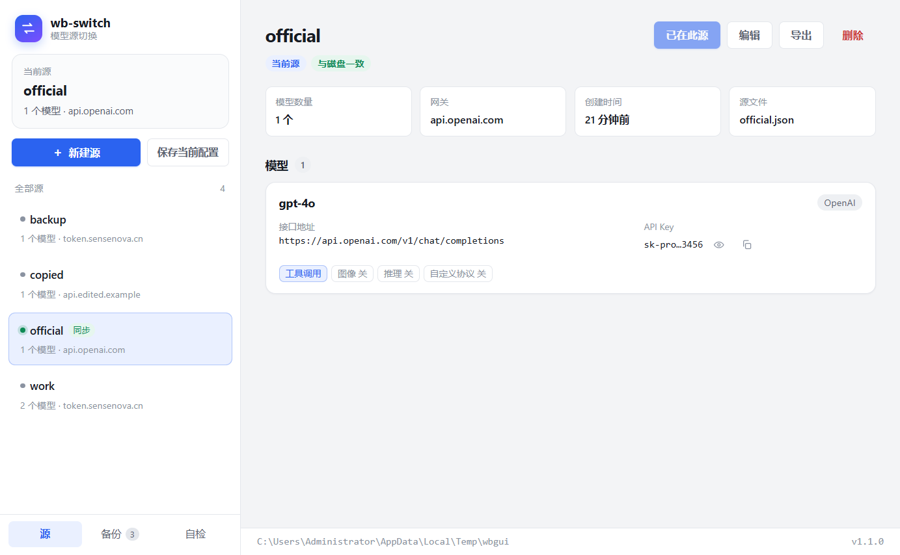
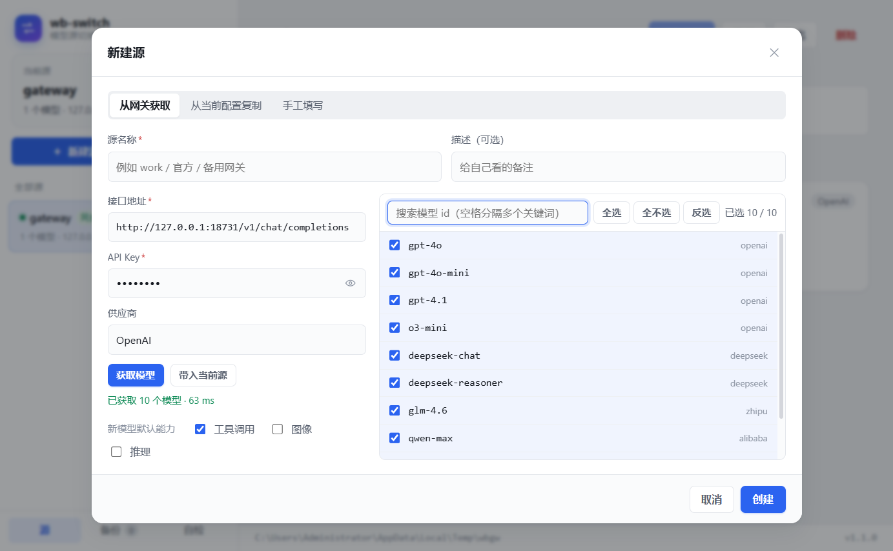

# wb-switch

WorkBuddy 的**模型源切换器**：把不同的模型网关配置存成一个个「源」，用图形界面一键来回切换，不用再手改 `~/.workbuddy/models.json`。



## 它解决什么问题

`C:\Users\<你>\.workbuddy\models.json` 里存着 WorkBuddy 的自定义模型（网关地址 + API Key）。官方源、中转站、公司内网网关往往只能存一份，换一个就得手工改一遍 JSON，改坏了还可能让客户端起不来。

wb-switch 把这些配置存成独立的「源」快照，切换时：

1. 对当前 `models.json` 拍一份临时快照（成功后立即删除；不默认进备份历史）
2. 原子写入目标源的配置
3. 回读校验，不一致自动用快照回滚
4. 更新「当前源」指针

任何一步失败都不会留下半截配置。

**备份默认是手动的**：切换不再自动往 `backups/` 归档。需要留档时点备份页的「立即备份」、跑 `wb-switch backup`，或临时加 `--backup`。想恢复旧行为就开 `wb-switch config autoBackup=on`（界面备份页也有开关）。

## 安装

提供两种形态，功能完全一致：

| 形态 | 文件 | 体积 | 说明 |
| --- | --- | --- | --- |
| **桌面应用** | `dist-app\wb-switch-Setup-1.5.0.exe` | 116 MB | 标准安装向导：选目录、创建快捷方式、控制面板可卸载 |
| 免安装版 | `dist-app\wb-switch-1.5.0-portable.exe` | 106 MB | 双击即用，不写注册表、不建快捷方式 |

### 安装版（推荐）

**安装**：双击 `wb-switch-Setup-1.5.0.exe`，或用 PowerShell：

```powershell
cd D:\www\wb-switch
powershell -ExecutionPolicy Bypass -File .\install.ps1
```

安装向导会引导你选安装目录、确认快捷方式，安装完成后自动启动。安装后会有：

- **桌面快捷方式** `wb-switch`
- **开始菜单** `wb-switch`
- **控制面板 → 应用和功能** 里有 `wb-switch`，可以正常卸载

**卸载**：控制面板里卸载，或：

```powershell
powershell -ExecutionPolicy Bypass -File .\install.ps1 -Uninstall
```

### 免安装版

双击 `wb-switch-1.2.0-portable.exe` 直接运行，不写注册表、不改系统设置。首次启动约 1–2 秒（要把内嵌运行时解到临时目录）。不需要就不卸载——删掉 exe 就行。

> 因为是无签名程序，首次运行可能弹 SmartScreen：点「更多信息 → 仍要运行」。个别杀软会报「可疑的已修改可执行文件」，把所在目录加入信任即可。

## 界面用法

### 第一次使用（三步）

1. 打开 wb-switch，左侧是空的，主区域提示「还没有任何源」
2. 点 **保存当前配置为源**，输入名字（例如 `work`），确定
3. 之后就能在左下角随时点另一个源 → **切换到此源**

「保存当前配置」= 把磁盘上现有的 `models.json` 原样存成一份快照，不改动任何东西。

### 主界面

- **左侧栏**：全部源列表，`●` 绿点是当前源；带「同步」标记表示该源内容与磁盘 `models.json` 完全一致。源多了用列表上方的搜索框过滤（按源名 + 网关，`Ctrl+F` 聚焦；`glm5` 能命中 `glm-5.2` 这类去掉 `-` `_` `.` 也能对上的写法）
- **当前源卡片**：显示当前源的模型数和网关主机
- **右侧详情**：每个模型一张卡片，含接口地址、API Key（默认脱敏，点眼睛图标显示、点复制图标复制）、能力标签（工具调用 / 图像 / 推理 / 自定义协议）
- **顶部按钮**：切换到此源、编辑、导出、删除

### 新建源



默认走「**从网关获取**」，三种方式并存：

| 方式 | 用法 | 适合 |
| --- | --- | --- |
| **从网关获取**（默认） | 填接口地址 + API Key → 点「获取模型」→ 搜索 / 勾选 → 创建 | 新网关、只想写入其中几个模型 |
| 从当前配置复制 | 把磁盘上现在的 `models.json` 原样存一份 | 先把现状存下来 |
| 手工填写 | 自己填 id、地址、Key，可加多个模型 | 网关没有 `/models` 接口 |

「从网关获取」的细节：

1. 打开就会**自动带入当前源的地址与密钥**并立刻拉一次列表（也可以点「带入当前源」或自己改）
2. 地址随便填哪种都行：`https://x/v1/chat/completions`、`https://x/v1`、`https://x`，工具统一换成 `/v1/models` 去取；404 时会自动换另一种写法重试
3. 列表支持**搜索**（空格分隔多个关键词，如 `deep reason`）、**全选 / 全不选 / 反选**
4. 每行是一个**开关**：勾上=写入，去掉=不要；右上角实时显示「已选 N / 共 M」
5. **只把勾选的模型写进新源**，其余忽略；新模型统一套用「默认能力」（工具调用 / 图像 / 推理）
6. 失败时会说明原因：401 密钥无效、404 没有该接口、域名解析失败、连接被拒绝、超时……

> 不需要的模型不用删——它压根不会被写进 `models.json`。

### 编辑源

改名、改描述、增删模型、改地址和 Key。**如果编辑的是当前源，保存时会同步写入 `models.json`**（写入前自动备份）。

### 导入与迁移

侧栏底部「**导入**」页，把别处的源一次性接进来：

| 入口 | 说明 |
| --- | --- |
| **迁移旧版 sources.json** | 旧版 `wbs`（Python）把源存在单个 `~/.workbuddy/wb-switch/sources.json` 里。点一下拆成多个 `profiles/*.json`，同名源默认跳过，不会覆盖手改过的内容 |
| **从 CC Switch 导入** | 读 `~/.cc-switch/cc-switch.db` 的 provider 表，按 Claude Code / Claude Desktop / Codex / Gemini / OpenCode 分组，可全选某一组、逐个勾选、勾「覆盖同名」；已存在的源会标「已存在」 |

导入完会显示结果卡片：导入 N 个 / 跳过 N 个（同名）/ 失败 N 个及原因。

> 导入的源只带外部工具里记录的模型清单。CC Switch 大多没存模型列表，导入后模型数会偏少 —— 打开该源「编辑 → 从网关追加模型」补全后再切换。

### 备份

**切换默认不再自动备份**，避免 `backups/` 越堆越多。备份页右上角「立即备份」随时手动存一份，列表里按时间查看、一键还原；还原前还会再备份一次当前配置，所以可以反悔。

想让每次切换都自动留档，勾上备份页的「切换时自动备份」（或 `wb-switch config autoBackup=on`）。关闭时切换仍会在写入失败时用临时快照自动回滚，只是不留历史记录。

### 自检

检查配置目录、写入权限、`models.json` 结构、源完整性、当前源指针是否与磁盘一致、备份状态。排查「切换没生效」时先看这里。

### 快捷键

| 按键 | 作用 |
| --- | --- |
| `Ctrl + N` | 新建源 |
| `Ctrl + S` | 切换到当前选中的源 |
| `Ctrl + E` | 编辑当前源 |
| `Ctrl + I` | 导入 JSON 文件 |
| `Ctrl + R` / `F5` | 刷新 |
| `Ctrl + F` | 聚焦搜索 |
| `Delete` | 删除当前选中的源 |
| `F2` | 重命名当前源 |
| `Esc` | 关闭弹窗 |

### 从模板创建

内置 16 家大厂配置模板（OpenAI / Claude / Gemini / DeepSeek / 智谱 / 通义 / 百度 / 豆包 / Kimi / MiniMax / 零一万物 / 商汤 / 硅基流动 / OpenRouter / Together / Groq）：

1. 选择厂商 → 自动预填常见模型列表
2. 填入 API Key → 点「获取模型」从网关刷新最新列表
3. 搜索 / 勾选 / 全选 / 反选 → 只写选中的模型

### 代理设置

底部状态栏点「代理」按钮，可设置 HTTP/HTTPS/SOCKS5 代理。留空则自动读取系统环境变量 `HTTP_PROXY` / `HTTPS_PROXY`。设上代理后，海外厂商（OpenAI、Gemini 等）也能获取模型列表。

### 暗色模式

底部状态栏的 `☀/☾/◐` 按钮三档切换：自动（跟随系统）/ 强制亮色 / 强制暗色。选择会记住，下次打开自动恢复。

### 批量操作

侧栏源列表 `Ctrl + 点击` 多选源，选中后可批量删除或批量导出到文件夹。

### 源对比

详情页点「对比」按钮，选另一个源，自动显示差异：绿色=新增、红色=删除、黄色=字段不同、灰色=一致。

### 系统托盘

关闭窗口自动最小化到系统托盘（不退出）。双击托盘图标恢复窗口。右键托盘菜单可直接切换源。

### 拖拽排序

编辑源时，模型列表可拖拽排序——拖动左侧 `⣿` 手柄放到目标位置即可。顺序影响 `models.json` 里的写入顺序。

## 多目标工具（v2.2）：不止 WorkBuddy

wb-switch 现在是一个**通用模型切换工具**，同一套「源 / 组合 / 网关」可以管理多个 AI 工具：

| 目标 | 配置文件 | 格式 | 协议 |
| --- | --- | --- | --- |
| **WorkBuddy** | `~/.workbuddy/models.json` | JSON 数组 | chat |
| **Codex** | `~/.codex/config.toml` | TOML | responses |

**界面里切换**：左侧栏顶部的「目标工具」下拉，点一下即可在 WorkBuddy / Codex 之间来回切。
切换后源列表、当前生效、备份都会跟着换到那个工具的视图（各自独立，互不影响）。

命令行也可以：

```bash
wb-switch targets              # 查看全部目标工具与当前项
wb-switch targets use codex    # 切到 Codex
wb-switch --target codex list  # 临时指定（不改全局设置）
```

**数据完全隔离**：每个目标有自己的源库、组合、备份和激活状态，互不干扰。

### Codex 接自定义网关

Codex 只支持 `wire_api = "responses"`，而多数中转站只有 `/v1/chat/completions`。
wb-switch 的网关做了**双向协议翻译**，所以任意 chat 上游都能给 Codex 用：

- 请求：`/v1/responses` → 翻译成 `messages` 后打上游 `chat/completions`
- 响应：上游 chat 结果 → 还原成 `output[]`（含正文 / 推理 / 工具调用）
- 流式：chat 的 delta chunk → responses 的 `response.output_text.delta` 等事件
- 工具调用：responses 的扁平 `tools` ↔ chat 的 `tools[].function`、`tool_calls`

切到 Codex 后 `wb-switch use <源或组合>` 会：

1. 把 `model` / `model_provider` 指向 wb-switch 网关
2. 写入 `[model_providers.wb-switch]`（`wire_api = "responses"`）
3. 为每个模型生成 profile 文件，用 `codex --profile <名称>` 切换
4. **只定点改这几处**，你原有的 `mcp_servers` / `notify` / 注释全部保留

## 它改了哪些文件

只改写目标工具的模型配置，其它配置一概不碰。**本工具的所有数据都在自己的目录 `~/.wb-switch/` 下**，
不会往 WorkBuddy / Codex 的配置目录里塞任何自己的文件：

```
~/.wb-switch/                        ← 工具的家（WB_SWITCH_HOME 可覆盖）
├── current-target.json              # 当前目标工具
├── settings.json                    # 全局设置
├── targets/
│   ├── workbuddy/
│   │   ├── profiles/<源名>.json     # 每个源一份快照
│   │   ├── backups/                 # 切换前 / 还原前 / 已删除的源
│   │   ├── images/                  # MCP 生成的图片（默认保存位置）
│   │   └── state.json               # 当前源指针
│   └── codex/                       # 同上，独立一套
└── gateway/                         # 网关（跨目标共享）
    ├── routes.json                  # 路由表
    ├── health.json                  # 后端健康度
    ├── gateway.pid                  # 进程号
    └── logs/gateway.log             # 请求日志
```

**从旧版升级自动迁移**：首次运行会把 `<WorkBuddy根>/wb-switch/` 里的源、备份、设置、
网关路由全部搬到上面这套结构里。规则是**只补缺失、绝不覆盖**，重复运行也不会重复追加日志。

搬完之后旧目录就没用了，工具不会再往那里写任何东西，可以放心删掉。

文件夹本身就是纯文本 JSON/TOML，可以手工备份、迁移、进 git。

**切换后需要重启目标工具（或新开一个对话）才会用上新配置**——客户端启动时会缓存模型列表。

## 命令行版（可选）

产物默认不保留（省 83 MB）。需要时先构建：

```bash
npm run build:exe     # → dist-exe/wb-switch.exe（单文件，无需 Node）
```

命令与桌面版操作的是同一份数据：

```bash
wb-switch                      # 交互式方向键选择
wb-switch init work            # 把当前 models.json 存为源
wb-switch list                 # 源列表，● 标当前
wb-switch use backup           # 切换
wb-switch diff backup          # 与磁盘对比
wb-switch backup               # 手动备份当前配置
wb-switch backups              # 备份列表
wb-switch restore 1            # 按序号还原
wb-switch use work --backup    # 本次切换顺带归档一份
wb-switch config               # 查看设置（autoBackup 等）
wb-switch doctor               # 环境自检
wb-switch migrate              # 把旧 sources.json 拆成多个源
wb-switch ccs                  # 只读列出 CC Switch 里的 provider
wb-switch import-ccswitch --app claude   # 从 CC Switch 导入（可按 app_type 筛）
```

`migrate` / `import-ccswitch` 默认跳过同名源，加 `--overwrite` 才覆盖；加 `--dry-run` 只列出不写入。

退出码：`0` 成功 / `2` 用法 / `3` 配置 / `4` 源 / `5` 环境。

## 网关：同名模型路由（v1.8 新增）

WorkBuddy 的 `models.json` 不允许两条配置叫同一个模型名。想「183 和 OpenRouter 都提供 `glm-4.7`，谁活着用谁」时，只能整个切源。网关功能把这个问题挪到本地解决：

```
WorkBuddy ──(models.json 固定指向本地网关)──▶ wb-gateway(127.0.0.1:7533) ──查路由表──▶ 183 / OpenRouter / Kimi ...
```

- `models.json` 里每个模型名只出现一次（指向网关），**同名冲突天然消失**
- 路由表配置每个别名的**有序后端列表**：第一个失败（连接失败 / 5xx / 401 / 403 / 429）自动落到下一个
- 零智能：不做协议转换、不做意图路由，只查表转发（OpenAI 兼容），日志记录每次 `alias → 后端 · 状态 · 耗时`
- 独立进程常驻（不依赖桌面应用），macOS 可装 launchd 开机自启

```bash
# 1. 配路由：glm-4.7 优先 183，挂了转 OpenRouter
wb-switch gateway route add glm-4.7 --profile 183 --model glm-4.7 --profile2 openrouter --model2 z-ai/glm-4.7

# 2. 后台启动 + 让 WorkBuddy 指向网关
wb-switch gateway start
wb-switch gateway bind            # 生成名为 gateway 的源并切换过去

# 3. 日常
wb-switch gateway routes          # 看路由表
wb-switch gateway logs            # 看请求日志（谁慢了、谁挂了一目了然）
wb-switch gateway lint            # 校验路由引用是否有效
wb-switch gateway install         # macOS 开机自启（launchd + KeepAlive）
```

路由表存在 `~/.workbuddy/wb-switch/routes.json`；换后端 = 改路由表（热加载即时生效），`models.json` 从此不动。

### v2.0 调度核心（失败分类 + 熔断 + 连通性测试）

网关不再是简单顺序转发，而是带运行时自愈的调度器（全部行为可通过 `routes.json` 配置）：

**失败分类处理**：

| 失败类型 | 判定 | 处理 |
|---|---|---|
| 瞬时（网络/超时/5xx/408） | 重试 3 次（指数退避 500ms 起、jitter ±30%），仍失败切下一个源 |
| 速率 429 | 带 `Retry-After` ≤60s → 不重试，冷却该后端至到期，立即切下一个 |
| 配额 429 | body 含 quota/balance/余额 等，或 Retry-After >60s → 冷却 30min，立即切下一个 |
| 鉴权 401/403 | 不重试，冷却 60min，立即切下一个 |
| 客户端 4xx（400/404…） | 不重试，切下一个源（不同源模型名不同，可能就对了） |
| 全链耗尽 | 502 + `x-wb-gateway` 诊断头（request_id + 每后端尝试摘要） |

**并发治理**：熔断器（连续 5 次瞬时失败 → open 冷却 30s → half-open 探测 → 恢复；探测失败冷却翻倍封顶 5min）；per-backend inflight 上限 6（超限排队 30s）；全链 60s 预算（`budgetMs` 可调，耗尽立即终态）；客户端取消传播（断开即中止重试与上游请求）；背压透传。

**连通性测试（只有测试通过的模型才能入组）**：

```bash
wb-switch add <名> --url <地址> --key <密钥>   # 默认 L2 测试：GET /v1/models（--no-test 跳过）
wb-switch combo add / gateway route add        # 默认 L3 测试：对目标模型发 max_tokens=1 真实请求
#   200 → pass；429 速率 → pass（degraded，限流中但鉴权/模型均通）
#   401/403/404/超时/配额 → fail，阻止加入（--force 强加标未验证）
wb-switch health check [源名|组合名]            # 手动复测并刷新 health.json（缓存 1h）
```

**可观测性**：`wb-switch gateway status` 展示每后端健康面板（熔断态/冷却剩余/成功率/p95/inflight/最近错误）；`GET /wb-gateway/stats` 返回 JSON 指标；每请求 `request_id` 贯穿日志。

```json
// routes.json 可选配置（全部有默认值，旧 retry=N 仍兼容）
{
  "retry": 3,                      // 每后端瞬时类重试次数
  "scheduling": "priority",        // priority（健康优先按序）| round-robin（轮转分摊）
  "budgetMs": 60000                // 全链时间预算
}
```

## 组合（v1.9）：多源模型聚合 + 追加模式

网关解决「同名模型」的路由；**组合**解决「把多个源的模型凑成一份配置」：

- **组合是一个独立的源**（`profiles/<名>.json` 带 `type: "combo"`），不拆分、不替换现有源
- **成员自由组合，不要求同名**：每个成员 = 一个别名 + 按序尝试的多个（源, 模型）后端，例如 `glm-any ← 183/glm-5.3 → Kimi/kimi-k3`
- **失败转移升级**：单后端失败先**重试 10 次**（`routes.json` 的 `retry` 可调），仍失败才切下一个源；网关**热加载**路由表，改完即时生效不用重启
- **选中组合 = 追加模式**：`use <组合名>` 不覆盖当前已选源，组合条目按顺序追加到 `models.json` 尾部；`state.appended` 记录追加顺序（`active` 保持首个源不变）
- **追加普通源同理**：`append <源名...>` 把源的模型按序追加（不整体替换）；后续追加沿用同一规则
- **重名保护**：组合名全局唯一（不能与源/组合重名）；追加时 id 冲突可 `--on-conflict error|skip|suffix`（默认报错，suffix 自动改名为 `id-2`）

```bash
# 1. 创建组合（成员 glm-any：183 优先，重试 10 次失败后转 Kimi）
wb-switch combo create mymix --profile 183 --model glm-5.3 --alias glm-any --profile2 Kimi --model2 kimi-k3

# 2. 组合再加一个成员（不同名的模型也行）
wb-switch combo add mymix --profile OpenCode --model claude-sonnet-4.5 --alias sonnet

# 3. 选中组合（追加模式：当前源 183 的条目原样保留，mymix 的成员追加在尾部）
wb-switch use mymix

# 4. 继续追加别的源（同样不覆盖）
wb-switch append ModelScope --on-conflict skip

# 5. 管理
wb-switch combo list / show mymix / lint
wb-switch combo rm-member mymix sonnet
wb-switch combo remove mymix
```

组合成员经本地网关转发（`127.0.0.1:7533`），记得网关在跑：`wb-switch gateway start`。普通源的 `use`（整体替换）逻辑完全不变，两者并存。

## 图片生成（v2.1）：SenseNova U1.5 等图片模型对接

图片模型（商汤 SenseNova U1.5 Lite / Fast 等）与 chat 模型共用同一套源体系（Bearer key、profiles、网关调度/熔断/预算全复用），仅端点不同（`/v1/images/generations`、`/v1/images/edits`）。

```bash
# 1. 源模型列表导入后，手动标记为图片生成模型（写入 api=images）
wb-switch image mark <源名> <模型ID>        # 例：image mark 183 sensenova-u1.5-lite
wb-switch image unmark <源名> <模型ID>     # 取消标记
wb-switch image models                     # 列出全部图片模型

# 2. 配置图片路由（多源 fallback 与 chat 路由一致）
wb-switch image route add u1.5-lite --profile 183 --model sensenova-u1.5-lite --profile2 131 --model2 sensenova-u1.5-lite

# 3. 生成 / 编辑（自动拉起网关；结果含 CDN URL 或落盘路径）
wb-switch image gen u1.5-lite "一只白色海豹宝宝" --size 1024x1024 --format png
wb-switch image edit u1.5-lite "换成夜景" --images /path/to/img.png
```

**两个调用入口**（都与现有模型调用方式一致）：

| 入口 | 说明 |
|---|---|
| **OpenAI Images API** | `POST http://127.0.0.1:7533/v1/images/generations`（model 填路由别名），`/v1/images/edits` 同理 |
| **chat 兼容入口** | 普通 `/v1/chat/completions` 请求发给 image 路由也可——网关自动提取 prompt/图片、包装回 chat 响应（markdown 图链），WorkBuddy 无需改动即可用 |
| **MCP 接口** | `wb-switch mcp`（stdio JSON-RPC），工具：`generate_image` / `edit_image` / `list_models`，图片自动下载落盘，供 WorkBuddy 或任意 agent 调用 |

**接入 WorkBuddy 的 MCP 配置示例**（`~/.workbuddy/mcp.json`）：

```json
{
  "mcpServers": {
    "wb-switch-image": {
      "command": "wb-switch",
      "args": ["mcp"]
    }
  }
}
```

**SenseNova 适配要点**：图片生成是长任务（U1.5 实测 ~100s），image 路由首字节超时放宽到 150s、预算 ≥180s；配额型 429（`token plan entitlement exhausted`）零重试冷却 30min 后切下一源；URL 仅 24h 有效，`image gen` 默认自动下载落盘。

## 从源码构建

```bash
npm install
npm run gui            # 开发模式直接开窗口
npm run build:app      # 只构建 app 目录（build/app）
npm run build:win       # 打包安装版 + 免安装版 → dist-app/
npm run build:exe      # 打包命令行单文件 exe → dist-exe/（按需）
npm test               # 51 命令行 + 27 模型获取 + 6 协议 + 15 网关 + 33 网关调度 + 30 组合 + 31 图片对接断言
npm run clean          # 清掉全部构建产物，只留 exe 与源码
```

打包链路：

```
src/gui/*.ts ──esbuild──▶ build/app/main.cjs ─┐
src/gui/renderer/*  ───────拷贝─────────────▶├─▶ electron-builder ─▶ dist-app/*.exe
本机 Electron 运行时（node_modules/electron/dist）
```

- 国内网络装 Electron 时若下载失败，加镜像：`ELECTRON_MIRROR=https://npmmirror.com/mirrors/electron/ node node_modules/electron/install.js`
- 打包 NSIS 资源同理：`ELECTRON_BUILDER_BINARIES_MIRROR=https://npmmirror.com/mirrors/electron-builder-binaries/`
- **从 Electron 宿主程序的终端里启动开发模式**时，需要先清掉宿主注入的 `ELECTRON_RUN_AS_NODE=1`（否则会把 Electron 当 Node 跑，报 `Cannot read properties of undefined (reading 'getVersion')`）：
  `env -u ELECTRON_RUN_AS_NODE npx electron build/app`
- 界面截图回归：设置 `WB_GUI_SHOT=<png 路径>` 启动，会自动截图并退出；配合 `WB_GUI_SCRIPT="<点击脚本>"` 可以截取任意弹窗或页面状态

## 按需构建其它形态

| 想要 | 命令 | 产物 | 体积 |
| --- | --- | --- | --- |
| 解压版（启动最快） | `npm run build:win -- --unpacked  # 额外保留解压版` | `dist-app\win-unpacked\` | 357 MB |
| 命令行单文件 | `npm run build:exe` | `dist-exe\wb-switch.exe` | 83 MB |
| 仅免安装版 | `npm run build:portable` | `dist-app\wb-switch-*-portable.exe` | 106 MB |

两者都是纯产物，随时可删、可重建；`npm run clean` 会一并清掉，`npm run clean -- --all` 连 `node_modules` 一起清（下次需重新 `npm install`）。

## 项目结构

```
src/
├── gui/
│   ├── main.ts          # Electron 主进程：窗口 + IPC（薄壳）
│   ├── preload.ts       # contextBridge 暴露受限 API
│   ├── service.ts       # 业务服务层（不依赖 Electron，可单独测试）
│   ├── modelFetch.ts    # 拉取网关模型列表：端点推导、多格式解析、错误翻译
│   └── renderer/        # 界面：index.html / styles.css / app.js（无框架）
├── gateway/
│   ├── routes.ts        # 路由表（routes.json）：别名 → 有序后端列表（支持 retry 与组合合并）
│   ├── server.ts        # 网关服务器：查表转发、流式透传、重试 10 次后切源、热加载、日志
│   ├── daemon.ts        # 守护进程管理：pid 文件、launchd 开机自启
│   └── cli.ts           # gateway 子命令组（start/stop/routes/bind/logs...）
├── combo.ts             # 组合存储：成员定义、重名校验、lint
├── combo-cli.ts          # combo 子命令组（create/add/rm-member/list/show/lint/remove）
├── appender.ts          # 追加模式：useCombo（组合选中=追加）/ appendProfile（追加普通源）
├── switcher.ts          # 切换核心：快照 → 原子写 → 回读校验 → 回滚
├── settings.ts          # 用户偏好（autoBackup 等）
├── profiles.ts          # 源存储、前缀解析、删除保留副本
├── migrate.ts           # 外部数据导入：旧 sources.json 迁移 + CC Switch SQLite 读取
├── config.ts            # models.json 解析校验、缩进/换行保真
├── fsutil.ts            # 原子写（Windows rename 重试）、备份、格式探测
├── state.ts / paths.ts / errors.ts / types.ts
└── cli.ts               # 命令行
assets/
└── icon.png / icon.ico  # 应用图标（512² PNG + 多尺寸 ICO，构建输入）
scripts/
├── build-gui.mjs        # esbuild 打主进程/预加载 → build/app
├── build-portable.mjs   # 调 electron-builder → 合并到 dist-app → 清临时目录
├── build-exe.mjs        # SEA 打包命令行版（按需）
├── make-icon.mjs        # 纯 Node 生成 PNG(512²) + ICO（无外部依赖）
├── apply-resources.mjs  # 写图标与版本信息
└── clean.mjs            # 清理构建产物
tests/
├── smoke.mjs            # 51 项命令行端到端断言
├── modelfetch.mjs       # 27 项模型获取断言（内置假网关）
├── gateway.mjs          # 15 项网关断言（转发/改写/失败转移/日志/bind）
└── combo.mjs            # 30 项组合断言（追加模式/重名校验/重试切源/热加载）
```

## 常见问题

| 现象 | 处理 |
| --- | --- |
| 切换后 WorkBuddy 没变化 | 重启 WorkBuddy，或新开一个对话（模型列表在启动时缓存） |
| 启动慢 1–2 秒 | portable 版每次要把内嵌运行时解到临时目录；想更快就 `npm run build:portable` 后用解压版 `win-unpacked` |
| SmartScreen / 杀软拦截 | 见「安装」小节的说明，选「仍要运行」或加白名单 |
| 界面全白 | 按 `F5` 重新加载；仍不行就开一次「自检」页，或 `npm run start -- doctor` 排查 |
| 提示「配置目录不存在」 | WorkBuddy 至少启动过一次才会生成 `%USERPROFILE%\.workbuddy` |
| 备份太多 | 已经默认手动备份了；历史遗留的旧备份可直接删 `wb-switch/backups/` |
| 源被删了想找回 | 备份页里有 `deleted-*.json`，还原即可 |

## 许可

MIT
